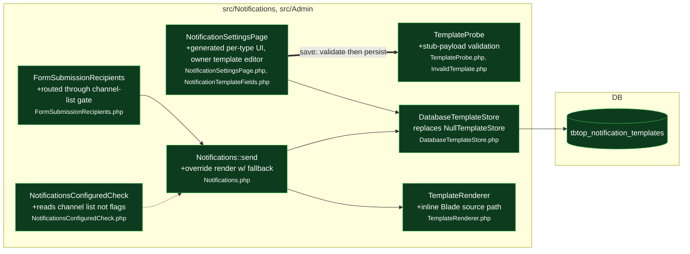

# feat(notifications): merchant-editable templates and per-type channel lists

touches: notification settings page, template store, template rendering, template validation, form.submission channel gating, notifications-configured health check

> ⚠️ **Migration** `database/migrations/2026_09_01_000000_create_notification_templates_table.php` — creates `tbtop_notification_templates` (`type`, `format`, `locale`, `subject`, `body`, unique on `(type, format, locale)`); guarded no-op if the table already exists.
> ⚠️ **Binding change** `TemplateStore::override()`'s signature is unchanged, but the package's default binding moves from `NullTemplateStore` (always `null`) to the new `DatabaseTemplateStore` — a host that referenced `NullTemplateStore` by class name breaks; a host that rebound the interface is unaffected.
> ⚠️ **Behavior change** `form.submission` drops its hand-coded `notifications.mail.enabled` / `notifications.telegram.enabled` gate and now resolves channels through `Notifications::enabledChannels('form.submission')`, default `['bell']` (was `['bell','mail','telegram']`). A host that had those legacy flags set to `true` stops sending mail/Telegram on upgrade until it sets `notifications.form.submission.channels` explicitly (documented in `docs/UPGRADING.md` with a one-line fix).
> ⚠️ Templates execute as real Blade (owner-admins only, `is_owner`) — see `docs/adr/0001-merchant-notification-templates-are-blade.md` for the security tradeoff against placeholder syntax / sandboxed Blade.

Every registered notification type now gets a per-(type, format, locale) merchant-editable Blade template, stored in the new table and edited from a `NotificationSettingsPage` that is generated entirely from `NotificationRegistry` instead of hand-listing `form.submission`. A saved override is probed against a stubbed payload before persisting (`TemplateProbe`); a stored override that fails at send time falls back to the built-in view and logs a warning rather than dropping the channel. `form.submission` now goes through the same generic per-type channel-list gate as every other registered type.

Wiring: `src/CmsServiceProvider.php` registers the new migration and rebinds `TemplateStore` to `DatabaseTemplateStore`; `docs/host/ai/inventory.md`, `docs/host/ai/notifications.md`, `docs/UPGRADING.md`, `CHANGELOG.md`, `CONTEXT.md` (new glossary file) and `docs/adr/0001-merchant-notification-templates-are-blade.md` (new, first ADR in the repo) document the feature; `resources/lang/{en,uk}/settings.php` add the new tabs/fields/errors and drop the two legacy toggle labels.

**Read by eye:**
- `database/migrations/2026_09_01_000000_create_notification_templates_table.php`
- `src/Notifications/Support/DatabaseTemplateStore.php`
- `src/Notifications/Support/TemplateProbe.php`
- `src/Notifications/Support/InvalidTemplate.php`
- `src/Notifications/TemplateRenderer.php`
- `src/Notifications/Notifications.php`
- `src/Admin/Pages/NotificationSettingsPage.php`
- `src/Admin/Pages/Support/NotificationTemplateFields.php`
- `src/Admin/Pages/SettingsPageBase.php`
- `src/Form/Notifications/FormSubmissionRecipients.php`
- `src/Health/Checks/NotificationsConfiguredCheck.php`
- `src/CmsServiceProvider.php`
- `docs/adr/0001-merchant-notification-templates-are-blade.md`

**Assumptions:**
- No host currently has a container binding or test referencing `Tbtop\Cms\Notifications\Support\NullTemplateStore` by class name — the class is deleted, not deprecated.
