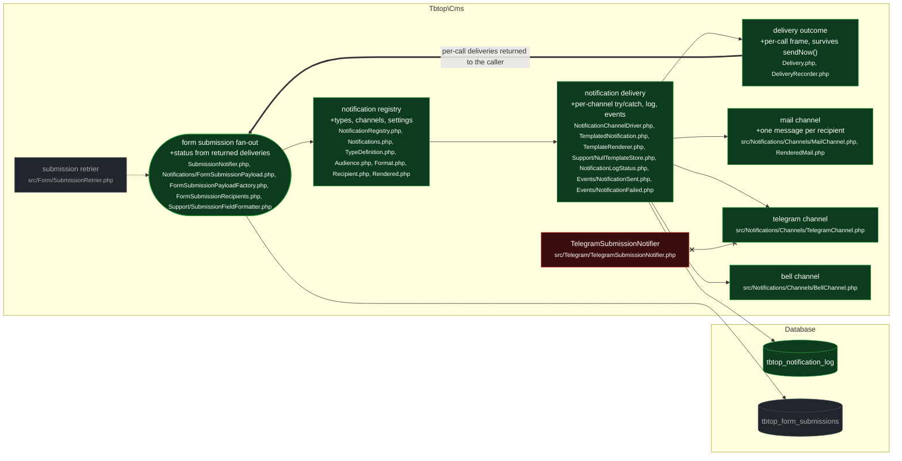

# feat(notifications): type and channel registry over Laravel notifications

touches: notification registry, notification delivery, delivery outcome, delivery log, mail channel, telegram channel, bell channel, submission fan-out, submission recipients, submission payload

> ⚠️ **Migration** `database/migrations/2026_08_27_000000_create_notification_log_table.php` — creates `tbtop_notification_log` (type, channel, audience, recipient, locale, status, error, sent_at). Additive, `Schema::hasTable` guarded, no backfill. Carries no correlation column to the entity that triggered a send, so the log is observability only — never a source callers read back.
> ⚠️ **Contract** `src/Notifications/Contracts/Channel.php` — new interface every channel must implement: `key()`, `label()`, `format()`, `settings()`, `supports(Recipient)`, `send(Rendered, Recipient, Settings)`. A channel reports failure by throwing; it never writes the log or the events itself.
> ⚠️ **Contract** `src/Notifications/Contracts/TemplateStore.php` — new interface, bound to `NullTemplateStore` today.
> ⚠️ **Contract** `Notifications::send(string $typeKey, object $payload, list<Recipient>): list<Delivery>` — returns one `Delivery` per attempted (recipient, channel) pair, in dispatch order. A per-channel failure is still never thrown; the caller reads it off the return value.
> ⚠️ **Contract change** `SubmissionMail` → `RenderedMail` on the form-submission mail path, and mailing N configured recipients is now N messages instead of one message addressed to all.

Adds a type/channel registry over Laravel's notification transport so a package
registers a type and its channels instead of hand-wiring mail/telegram/bell.
Every delivery attempt writes a `tbtop_notification_log` row, dispatches
`NotificationSent`/`NotificationFailed`, and is returned to the caller as a
`Delivery`. `form.submission` is migrated onto it: `SubmissionNotifier` becomes a
caller of `Notifications::send()` and derives the submission status from the
returned deliveries.

Intent says `SubmissionNotifier` "recovers each channel's outcome from the log
rows written during that call"; the diff no longer does that. That approach was
a global id watermark (`max(id)` before the send, then `id > $since AND type =
'form.submission' AND status = Failed`) over a table shared by every concurrent
request. The fan-out runs in `app()->terminating()`, so two submissions in
different workers overlap and one picks up the other's failure row — reproduced:
submission A's own deliveries all `Sent`, a concurrent `Failed` row written
mid-send, A released as `Failed` with B's error, and the retrier then replays a
fan-out that had succeeded. `send()` now returns the deliveries it made and
`SubmissionNotifier` reads only those.

Delivery outcomes cannot travel back as a return value from the channel class —
Laravel's `Notification::sendNow()` discards it — so `DeliveryRecorder` carries
them: `send()` opens a frame, the driver records into the innermost one, `send()`
drains it in a `finally`. Frames nest so a channel that itself sends a
notification cannot steal the outer call's deliveries.

Verified separately: `TelegramSubmissionNotifier`'s deletion is safe — no
remaining caller or binding, only a comment reference in `TelegramChannel`.

Tests: `tests/Notifications/NotificationsTest.php` is new and covers the registry
end to end through `RecordingChannel` / `RecordingShortChannel` /
`TestNotificationPayload` (`tests/Fixtures/`), including that `send()` returns one
`Delivery` per attempted pair and that an unrelated failed log row never enters
the result. `tests/Form/SubmissionNotifierTest.php` adds the regression at the
real seam — a concurrent `Failed` row written *during* the fan-out (a row written
*before* it is excluded by the old watermark too, and proves nothing): red on the
log-query version, green on this one. Three existing tests were adapted rather
than extended — `SubmissionNotifierTest`, `SubmissionRetrierTest`,
`FormSubmitTest` — swapping `SubmissionMail` for `RenderedMail`, with the
multi-recipient case now asserting two per-address messages.

Wiring: `src/CmsServiceProvider.php` binds `NotificationRegistry`, `DeliveryRecorder`, `TemplateRenderer`, `TemplateStore` and registers the three channels, the `form.submission` type and the new migration; `docs/UPGRADING.md` documents registering a channel/type, reading `send()`'s return value, and why the log must not be queried back; the two new Blade bodies `resources/views/notifications/form-submission/html.blade.php` and `short.blade.php`.

**Read by eye:**
- `src/Form/SubmissionNotifier.php`
- `src/Notifications/Notifications.php`
- `src/Notifications/NotificationChannelDriver.php`
- `src/Notifications/DeliveryRecorder.php`
- `src/Notifications/Delivery.php`
- `src/Notifications/Contracts/Channel.php`
- `src/Notifications/Contracts/TemplateStore.php`
- `src/Notifications/TypeDefinition.php`
- `src/Notifications/Models/NotificationLog.php`
- `database/migrations/2026_08_27_000000_create_notification_log_table.php`
- `src/CmsServiceProvider.php`
- `src/Notifications/Channels/MailChannel.php`
- `src/Notifications/Channels/TelegramChannel.php`
- `src/Notifications/Channels/BellChannel.php`
- `src/Form/Notifications/FormSubmissionRecipients.php`

**Assumptions:**
- Merchants tolerate N separate emails where they previously received one message listing every recipient in `To:` — recipients can no longer see each other.
- `tbtop_notification_log` grows unbounded: no pruning, retention or archival ships with this change, and every delivery attempt writes a row.
- A misconfigured channel key in settings is skipped silently — no log row, no event, no error surfaces to the operator.
- `NotificationRegistry`'s docblock claims channel resolution is lazy, but `registerChannel()` calls `app($class)` at registration time; a channel with a heavy or not-yet-configured constructor fails at boot.
- `Channel::settings()` is part of the contract but has no consumer in this change — `NotificationSettingsPage` does not read the registry, so a third-party channel's fields do not appear in the admin.
