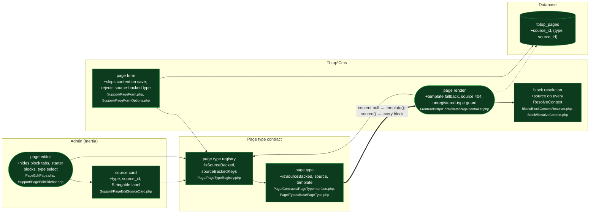

# feat(pages): source-backed page types render a template

touches: page type, page type registry, page render, block resolution, page editor, page form, source card, page record

> ⚠️ **Migration** `database/migrations/2026_08_31_000001_update_pages_add_source_table.php` — adds nullable `source_id` to `tbtop_pages` plus a composite `(type, source_id)` index. Additive, `Schema::hasColumn` guarded, no backfill. `down()` drops the index and the column. There is no `source_type` column: `type` alone identifies the kind of source, so a source is addressed by the pair.
> ⚠️ **Contract** `PageTypeInterface` — three new methods every implementer must have: `isSourceBacked(): bool`, `source(Page): ?object`, `template(Page): ?array`. `BasePageType` defaults them to `false`/`null`/`null`, so a type extending it is unaffected; a host implementing the interface directly breaks at load.
> ⚠️ **Contract** `BlockContentResolver::resolve(array $content, ?Page $page = null, ?object $source = null)` and `ResolveContext::$source` — new trailing parameter and new public property. Positional callers are unaffected; `ResolveContext`'s constructor takes `$source` after two private promoted params, so only a named argument reaches it.
> ⚠️ **Contract** `PageFormOptions::types(bool $includeSourceBacked = true)` — new leading-default parameter. Existing no-arg callers keep the full list; both in-package callers now pass `false`.

A page type can be backed by a domain object owned elsewhere. Such a page stores
`source_id` and a null `content`, renders its type's `template()` instead of an
empty page, and hands the resolved `source()` to every block. The page editor
turns read-only for it — no block tabs, no type select, a Source card instead —
and creating or retyping into a source-backed type is rejected server-side, not
just hidden in the form.

Intent says the editor "hides block editing entirely — saving leaves `content`
untouched"; the diff hides it and skips `content`/`starter_blocks` on save, but
nothing stops a hand-built POST from writing `content` on a source-backed page —
`PageForm::save()` skips the *write*, so the stored value survives, which is the
same outcome by a different route. The type field is guarded server-side;
`content` is not, and does not need to be.

Intent (`refactor(pages): key a source-backed page by (type, source_id)`) says
`PageTypeRegistry` "follows the new contract". It adds `sourceBackedKeys()`,
which has no caller anywhere in `src/` — only its own test asserts it. Dead
public surface on a shipped contract.

The unregistered-type guards are fixes committed on top of the original slice,
not part of it. The slice resolved `$page->type` through
`PageTypeRegistry::get()`, which throws, and `pages.type` is an unconstrained
string column, so a page whose type a host later removed from config 500'd
instead of rendering. Two seams were affected: `PageController` on the frontend,
and the admin read path, where `PageEditPage::isSourceBacked()` and
`PageEditSidebar::build()` both reach `PageTypeRegistry::isSourceBacked()`.
`PageController` guards with `has()` at the call site; the registry method now
returns `false` for an unknown key, which fixes both admin callers at once.
Both were verified green on the merge-base and red on the branch before the fix.
`PageHierarchy`'s existing `DomainException` does not cover either: it guards
writes only, via the `saving`/`updating` observer.

Tests: `tests/Frontend/SourceBackedPageRenderTest.php` and
`tests/Admin/PageEditSourceBackedTest.php` are new and drive the feature through
the real routes — template fallback, explicit content winning over the template,
the missing-source 404, the source reaching a block, the hidden tabs and Source
card, `content` staying null across a save, and both hand-submitted-type
rejections. `tests/Page/PageTypeRegistryTest.php` covers the three defaults on
every built-in type plus the two new registry methods;
`tests/Block/BlockContentResolverTest.php` asserts `$source` lands on the
`ResolveContext`; `tests/Support/SourceColumnsMigrationTest.php` asserts the
column exists and `source_type` does not. Fixtures `SourcedType`,
`SourcedThing`, `SourceAwareBlock` are new. `tests/Pest.php` gains three
structure-tree walkers moved out of `PageEditPageTest.php`, which had made the
new admin file pass only when the older one happened to load.

Wiring: `src/CmsServiceProvider.php` registers the migration; `src/Page/Models/Page.php` adds `source_id` to `$fillable` and the property docblock; `resources/lang/{en,uk}/pages.php` add the Source section, two field labels and the `type_source_backed` validation message; `docs/UPGRADING.md` documents the column, the three interface methods, `ResolveContext::$source` and the editor behaviour.

**Read by eye:**
- `src/Page/Contracts/PageTypeInterface.php`
- `src/Page/Types/BasePageType.php`
- `src/Page/PageTypeRegistry.php`
- `src/Frontend/Http/Controllers/PageController.php`
- `src/Admin/Pages/Support/PageForm.php`
- `src/Admin/Pages/PageEditPage.php`
- `src/Admin/Pages/Support/PageEditSidebar.php`
- `src/Admin/Pages/Support/PageEditSourceCard.php`
- `src/Admin/Pages/Support/PageFormOptions.php`
- `src/Block/ResolveContext.php`
- `src/Block/BlockContentResolver.php`
- `database/migrations/2026_08_31_000001_update_pages_add_source_table.php`
- `src/Page/Models/Page.php` (fillable + docblock only)

**Assumptions:**
- No host implements `PageTypeInterface` without extending `BasePageType`; such an implementation stops loading the moment this ships.
- `source_id` is a string wide enough for every host's identifier, and a source key is expressible as a single scalar — a composite or numeric key must be encoded by the host.
- `source_id` is in `$fillable` but no cms code writes it; the host's sync is trusted to set it, and nothing enforces that a source-backed page has one (`source()` receives a null `source_id` and must handle it).
- `template()` is called on every render of a source-backed page with no caching between the call and the block resolver; a host that builds it expensively pays that per request.
- The `(type, source_id)` index is not unique, so nothing prevents two pages claiming the same source.
